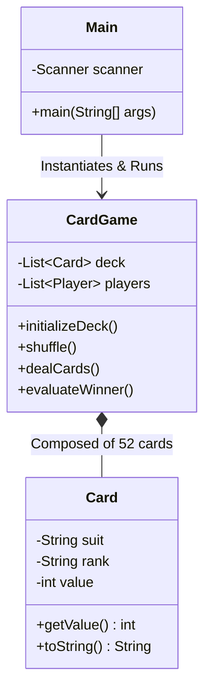

<p align="center">
  
</p>

<p align="center">
  
  
  
  
</p>

<a id="overview"></a>
## 📖 Executive Summary & Overview

The **Card Battle Engine** (`CardGame`) is an object-oriented Java application demonstrating classical OOP design patterns, game loop mechanics, and state encapsulation. Card game simulations require deterministic deck lifecycle management: dynamic initialization, cryptographic-grade shuffle randomness, turn-based card distribution, and automated hand evaluation.

This project implements a fully encapsulated card game model backed by an architectural **Object Level Diagram**, decoupling user input handling in `Main.java` from domain game rules and deck state in `CardGame.java`.

<a id="toc"></a>
## 📑 Table of Contents

- [📖 Executive Summary & Overview](#overview)
- [🎯 Key Features & Capabilities](#features)
- [🏗️ System Architecture & Pipeline](#architecture)
- [🛠️ Tech Stack Breakdown](#tech-stack)
- [⚙️ Reproducible Quickstart & Setup](#setup)
- [📁 Project Directory Layout](#project-layout)
- [👨‍💻 Author & Contributions](#author)

<a id="features"></a>
## 🎯 Key Features & Capabilities

- **Encapsulated Deck Representation:** Complete modeling of 52-card standard decks with rank, suit, and value properties.
- **Randomized Shuffle Mechanics:** Algorithmic card permutation ensuring uniform distribution across deals.
- **Turn-Based Game Controller:** Turn execution loop enforcing state validation, player scoring, and victory conditions.
- **CLI Interactive Flow:** User prompts via `java.util.Scanner` with input sanitization and score reporting.
- **Architectural UML Modeling:** Packaged with `Object level Diagram.png` specifying entity relationships and method contracts.

<a id="architecture"></a>
## 🏗️ System Architecture & Pipeline



<a id="tech-stack"></a>
## 🛠️ Tech Stack Breakdown

| Technology | Purpose | Implementation Details |
| :--- | :--- | :--- |
| **Language** | Java (JDK 11 / 17+) | Core object-oriented language |
| **Libraries** | Java Standard Library (`java.util.*`) | Collections, Random, Scanner |
| **Modeling** | UML Object Diagram | Visualizing class interactions and aggregation |
| **Build Tooling** | `javac` / `java` CLI | Zero-dependency standard compilation |

<a id="setup"></a>
## ⚙️ Reproducible Quickstart & Setup

### Prerequisites
- Java Development Kit (JDK 11 or higher)

```bash
# 1. Clone repository
git clone https://github.com/Amaraiah11/CardGame.git
cd CardGame

# 2. Compile Java source files
javac Main.java CardGame.java

# 3. Launch game simulation
java Main
```

<a id="project-layout"></a>
## 📁 Project Directory Layout

```text
CardGame/
├── CardGame.java              # Core card game domain logic and deck management
├── Main.java                  # Application entry point and interactive CLI loop
├── Object level Diagram.png   # Architectural UML diagram depicting class contracts
└── README.md                  # Comprehensive project documentation
```

<a id="author"></a>
## 👨‍💻 Author & Contributions

This project is developed and maintained with high technical rigour by **Amaraiah C**, Software Engineer and Data Analytics Practitioner studying Bachelor of Computer Applications (BCA) at Alliance University.

- 🌐 **GitHub:** [@Amaraiah11](https://github.com/Amaraiah11)
- 💼 **LinkedIn:** [Connect on LinkedIn](https://www.linkedin.com/in/amaraiah-c/)
- 📧 **Institutional Contact:** `camaraiahBCA24@ced.alliance.edu.in`

### 🤝 Contribution Guidelines
Contributions, bug reports, and architectural discussions are welcome!
1. **Fork** the repository: `https://github.com/Amaraiah11/CardGame`
2. **Branch**: `git checkout -b feature/your-feature-name`
3. **Commit**: `git commit -m "feat: enhance feature logic"`
4. **Push**: `git push origin feature/your-feature-name`
5. **Open Pull Request** against the `main` branch.

---

<p align="center">
  <b>⭐ If this codebase or documentation assisted your engineering workflows, please star the repository! ⭐</b>
</p>

<p align="center">
  
</p>
