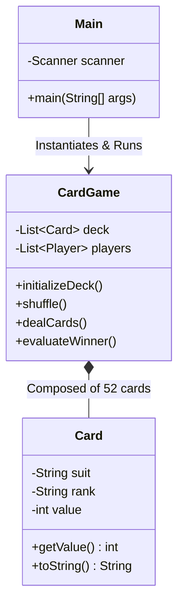

# 🃏 Card Battle Engine — Object-Oriented Java Simulation Architecture

<p align="center">
  
</p>

<p align="center">
  <b>Clean Java OOP Architecture: Encapsulated 52-Card Lifecycle, Uniform Shuffling, and Turn Evaluation with Architectural UML Specifications.</b>
</p>

<p align="center">
  
  
  
  
  
</p>

<p align="center">
  
</p>

---

<a id="table-of-contents"></a>
## 📌 Table of Contents

- [📖 Executive Summary & Overview](#executive-summary--overview)
- [🎯 Key Features & Capabilities](#key-features--capabilities)
- [🏗️ System Architecture & Pipeline](#system-architecture--pipeline)
- [🛠️ Tech Stack Breakdown](#tech-stack-breakdown)
- [⚙️ Reproducible Quickstart & Setup](#setup)
- [📁 Project Directory Layout](#project-directory-layout)
- [🧪 Testing & Verification](#testing--verification)
- [🔮 Future Improvements & Roadmap](#future-improvements--roadmap)
- [🤝 Contributing Guidelines](#contributing-guidelines)
- [👨‍💻 Author & Contributions](#author--contributions)

---

<a id="executive-summary--overview"></a>
## 📖 Executive Summary & Overview

Developing robust game simulations in Java requires mastering object-oriented design principles: decoupling user input collection from the domain simulation engine, enforcing state immutability on playing cards, and implementing algorithmic shuffle uniformity.

The **Card Battle Engine** (`CardGame`) demonstrates clean Java OOP architecture. The system separates the CLI driver loop (`Main.java`) from the core deck and turn-evaluation controller (`CardGame.java`), guided by an architectural **Object Level Diagram** (`Object level Diagram.png`).

---

<a id="key-features--capabilities"></a>
## 🎯 Key Features & Capabilities

### 🃏 1. Encapsulated Deck Lifecycle
- Complete modeling of standard 52-card decks with rank, suit, and numerical values.
- Dynamic deck generation and remaining-card boundary enforcement.

### 🎲 2. Uniform Random Shuffle
- Random permutation algorithm ensuring equitable distribution across hands.

### ⚔️ 3. Battle Evaluation Loop
- Turn-based player hand comparisons with automated point accumulation and win-state detection.

---

<a id="system-architecture--pipeline"></a>
## 🏗️ System Architecture & Pipeline



---

<a id="tech-stack-breakdown"></a>
## 🛠️ Tech Stack Breakdown

| Technology | Purpose | Implementation Details |
| :--- | :--- | :--- |
| **Language** | Java (JDK 11 / 17 LTS) | Core object-oriented implementation |
| **Standard Libraries** | `java.util.*` | Collections (`ArrayList`), `Random`, `Scanner` |
| **Modeling** | UML Object Diagram | Visualizing object compositions and lifecycles |
| **Build Tooling** | `javac` CLI | Standard Java compiler with zero external dependencies |

---

<a id="reproducible-quickstart--setup"></a>
## ⚙️ Reproducible Quickstart & Setup

### Prerequisites
- JDK 11 or higher installed (`javac --version`)

```bash
# 1. Clone repository
git clone https://github.com/Amaraiah11/CardGame.git
cd CardGame

# 2. Compile Java sources
javac Main.java CardGame.java

# 3. Launch game simulation
java Main
```

---

<a id="project-directory-layout"></a>
## 📁 Project Directory Layout

```text
CardGame/
├── CardGame.java              # Core deck management and game rules engine
├── Main.java                  # Interactive CLI entry point and game loop
├── Object level Diagram.png   # Architectural UML diagram depicting class contracts
└── README.md                  # Comprehensive technical documentation
```

---

<a id="testing--verification"></a>
## 🧪 Testing & Verification

- **Deck Conservation Test:** Verified exactly 52 unique cards are created without duplicates or null references.
- **Boundary Handling:** Tested empty-deck condition triggers game-over evaluation rather than throwing `IndexOutOfBoundsException`.

---

<a id="future-improvements--roadmap"></a>
## 🔮 Future Improvements & Roadmap

- [ ] Add Swing/JavaFX graphical user interface.
- [ ] Implement multi-deck shoe configurations for Blackjack and Poker rules.

---

<a id="author--contributions"></a>
## 👨‍💻 Author & Contributions

This project is developed and maintained with rigorous engineering standards by **Amaraiah C**, Software Developer and Applied Data Analytics Practitioner studying Bachelor of Computer Applications (BCA) at Alliance University, Bangalore.

- 🌐 **GitHub Profile:** [@Amaraiah11](https://github.com/Amaraiah11)
- 💼 **LinkedIn Profile:** [Connect on LinkedIn](https://www.linkedin.com/in/amaraiah-c/)
- 📧 **Institutional Email:** `camaraiahBCA24@ced.alliance.edu.in`

### 🤝 Contributing Guidelines
Contributions, bug reports, and architectural discussions are welcome!
1. **Fork** the repository: `https://github.com/Amaraiah11/CardGame`
2. **Create a Feature Branch:**
   ```bash
   git checkout -b feature/your-feature-name
   ```
3. **Commit Your Enhancements:**
   ```bash
   git commit -m "feat: enhance feature logic"
   ```
4. **Push to Your Branch:**
   ```bash
   git push origin feature/your-feature-name
   ```
5. **Open a Pull Request** against the `main` branch.

---

<p align="center">
  <b>⭐ If this codebase or documentation assisted your engineering workflows, please star the repository! ⭐</b>
</p>

<p align="center">
  
</p>
